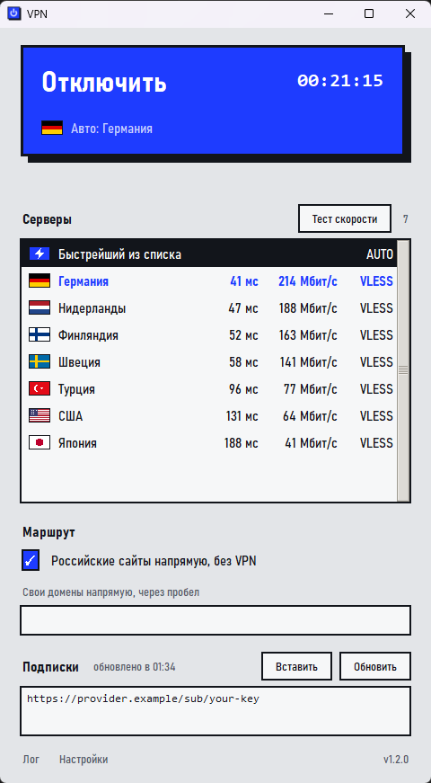
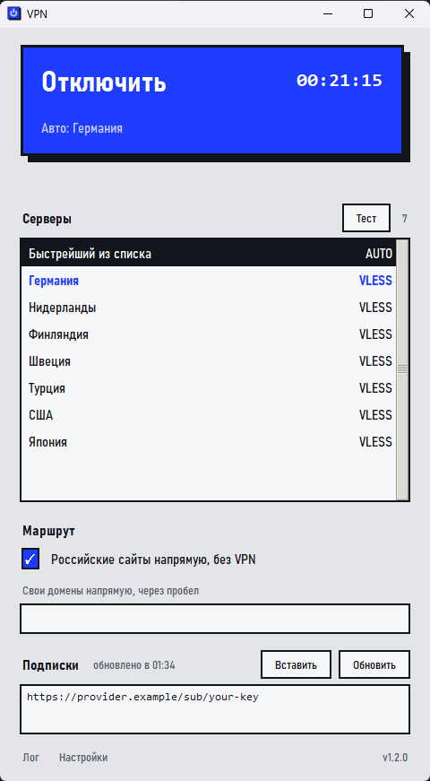

<p align="center">
  
</p>

<p align="center">
  <a href="https://github.com/serafimbelskih32-source/windows-vpn-client/releases/latest"></a>
  <a href="https://github.com/serafimbelskih32-source/windows-vpn-client/releases"></a>
  
  <a href="LICENSE"></a>
</p>

Простой VPN-клиент: вставляешь ссылку-подписку от своего VPN-провайдера, выбираешь сервер и нажимаешь одну кнопку. Весь трафик компьютера идёт через VPN. Устанавливать ничего не нужно: скачал и запустил.

<p align="center">
  
  &nbsp;&nbsp;
  
</p>
<p align="center"><sub>Полный вид и минималистичный: всё лишнее отключается в «Настройках».</sub></p>

## Скачать

| Система | Файл | Как запустить |
|---|---|---|
| **Windows** 10 и 11 | [FimaVPN.exe](https://github.com/serafimbelskih32-source/windows-vpn-client/releases/latest/download/FimaVPN.exe) | Запусти и разреши права администратора. |
| **Linux** x86_64 | [FimaVPN-linux-x86_64](https://github.com/serafimbelskih32-source/windows-vpn-client/releases/latest/download/FimaVPN-linux-x86_64) | `chmod +x FimaVPN-linux-x86_64`, потом `./FimaVPN-linux-x86_64`. |
| **Linux** ARM64 | [FimaVPN-linux-arm64](https://github.com/serafimbelskih32-source/windows-vpn-client/releases/latest/download/FimaVPN-linux-arm64) | То же, что и выше. |
| **macOS** Apple Silicon (M1 и новее) | [FimaVPN-macos-arm64.zip](https://github.com/serafimbelskih32-source/windows-vpn-client/releases/latest/download/FimaVPN-macos-arm64.zip) | Распакуй, при первом запуске нажми правой кнопкой на программу и выбери «Открыть». |
| **macOS** Intel | [FimaVPN-macos-x86_64.zip](https://github.com/serafimbelskih32-source/windows-vpn-client/releases/latest/download/FimaVPN-macos-x86_64.zip) | То же, что и выше. |

Все файлы и контрольные суммы: [страница релизов](https://github.com/serafimbelskih32-source/windows-vpn-client/releases/latest).

> **Про Linux и macOS честно.** Эти версии собираются и проходят автоматические проверки на GitHub (окно открывается, ссылки разбираются, а логика запуска и остановки ядра проверена на подставном ядре без прав администратора), но на настоящем компьютере с Linux или Mac я их не запускал. Если что-то не работает, [открой Issue](https://github.com/serafimbelskih32-source/windows-vpn-client/issues) и приложи текст из раздела «Лог».

## Как начать

1. **Запусти программу.** Windows спросит права администратора, чтобы создать виртуальный сетевой адаптер: нажми «Да». На Linux и macOS пароль попросят позже, в момент подключения.
2. **Вставь подписку.** Скопируй ссылку, которую выдал твой VPN-провайдер (обычно начинается с `https://`), и нажми «Вставить» в разделе «Подписки». Можно вставить сразу несколько ссылок или отдельные ключи (`vless://`, `vmess://`, `trojan://`, `ss://`, `hysteria2://`, `tuic://`), по одному в строке.
3. **Выбери сервер.** «Быстрейший из списка» подберёт его сам и сам будет переключаться, если сервер станет хуже. Чтобы выбрать вручную, нажми «Тест скорости»: программа измерит пинг и скорость у серверов и покажет лучших вверху списка.
4. **Нажми «Подключить».** Большая кнопка станет синей, рядом пойдёт таймер. Чтобы выключить VPN, нажми её ещё раз.

Подписки, настройки и выбранный сервер запоминаются, при следующем запуске вводить ничего не нужно.

> Программа **не продаёт и не предоставляет VPN**. Она подключается к серверам, ссылку на которые у тебя уже есть от провайдера или от твоего собственного сервера.

## Что умеет

- **Протоколы:** VLESS (Reality, gRPC, WebSocket), VMess, Trojan, Shadowsocks, Hysteria2, TUIC.
- **Показывает, к какому серверу подключён.** Если выбран «Быстрейший из списка», на большой кнопке написано «Авто: …» и название реального сервера, а строка в списке выделена синим.
- **Флаг показывает реальную страну сервера.** До теста флаг берётся из названия. После «Тест скорости» программа спрашивает у Cloudflare, откуда сервер выходит в интернет, и рисует флаг по этому ответу, потому что название у провайдера может не совпадать с реальностью. Если не совпало, это написано под большой кнопкой. Результат запоминается.
- **Минималистичный вид.** В «Настройках» (мелкая серая ссылка внизу окна) флаги, пинг и скорость включаются и выключаются **по отдельности**. Что выключено, то не показывается и **не измеряется**: без скорости тест не качает файлы, без пинга не меряет отклик. Остаётся только список названий.
- **Значок в области уведомлений.** Windows: значки у часов справа внизу (часто под стрелочкой «^»), macOS: строка меню сверху, Linux: системный трей. Серый значок: VPN выключен, синий: подключён. Меню: «Показать окно», «Подключить» или «Отключить», «Выход». По умолчанию кнопка закрытия окна сворачивает программу в трей, а не выключает VPN; это отключается в «Настройках».
- **Повторный запуск не плодит окна:** если программа уже работает (в том числе в трее), второй запуск выводит её окно вперёд.
- **Подписки обновляются сами** по интервалу, который сообщает провайдер. Если провайдер недоступен, остаются последние сохранённые серверы.
- **Российские сайты без VPN.** Галочка «Российские сайты напрямую» пускает российские сервисы мимо VPN, а остальное через него. Свои исключения можно дописать в поле ниже. Списки обновляются раз в неделю.
- **Тест скорости работает и при включённом VPN:** замер идёт мимо него, напрямую в интернет.
- **Не оставляет сеть сломанной.** Если окно закрыто аварийно, ядро VPN завершается вместе с ним и интернет не пропадает.

## Автообновление

При первом запуске программа спросит, обновляться ли автоматически. Если ты согласился:

1. Раз в несколько часов она смотрит, не вышла ли на GitHub новая версия.
2. Новая версия скачивается только с GitHub (по `https` и только с адресов GitHub), её **контрольная сумма сверяется** с файлом `SHA256SUMS.txt` из того же релиза. Если сумма не совпала, файл отбрасывается.
3. Установка происходит при следующем запуске или закрытии программы, VPN во время работы не прерывается. Вместо ожидания можно нажать «Установить» в «Настройках».

Включить и выключить автообновление и проверить версию вручную можно в «Настройках» внизу окна, номер установленной версии написан справа от них. Если автообновление выключено, программа сама ничего не проверяет и не скачивает.

Контрольная сумма защищает от повреждённой загрузки, но не от подмены самого релиза: обновление доверяет этому репозиторию. Если ты не хочешь этого, выключи автообновление и собирай из исходников.

## Частые вопросы

**Windows пишет «Система Windows защитила ваш компьютер».**
Программа не подписана платным сертификатом, поэтому SmartScreen и некоторые антивирусы настораживаются. Нажми «Подробнее» → «Выполнить в любом случае». Если не доверяешь готовому файлу, собери его сам из исходников (ниже): всё открыто.

**macOS пишет, что программу нельзя открыть.**
Нажми на неё правой кнопкой, выбери «Открыть» и подтверди. Один раз этого достаточно. Либо в терминале: `xattr -dr com.apple.quarantine FimaVPN.app`.

**На Linux не открывается окно пароля.**
Нужен `pkexec` (пакет `polkit`) и запущенный графический агент polkit: в обычных рабочих окружениях (GNOME, KDE, XFCE) он есть. Без него подключиться нельзя: ядру VPN нужны права для создания сетевого адаптера.

**Значка в трее не видно.**
В Windows новые значки прячутся под стрелочкой «^» у часов: перетащи значок на панель, чтобы он был всегда на виду. На Linux значок виден в рабочих окружениях с треем (XFCE, KDE, MATE и др.); в GNOME трея по умолчанию нет, поставь расширение AppIndicator. Если значка нет вовсе, программа работает как обычно, а кнопка закрытия окна просто закрывает её.

**Не подключается.**
Открой раздел «Лог» внизу окна: там причина. Частые причины: подписка устарела (проверь её в кабинете провайдера), запущен другой VPN (Karing, v2rayN, Hiddify, NekoRay: выключи его), на Windows нет прав администратора.

**Где взять подписку?**
У VPN-провайдера или на собственном сервере (панели 3x-ui, Marzban, Remnawave выдают такие ссылки).

**Где хранятся данные?**
Windows: `%APPDATA%\FimaVPN`. Linux: `~/.config/FimaVPN`. macOS: `~/Library/Application Support/FimaVPN`. Там настройки, сохранённые серверы и логи. Ссылки-подписки работают как пароль: не публикуй их и не присылай другим.

## Сборка из исходников

Нужен Python 3.12+ с tkinter.

```powershell
# Windows
git clone https://github.com/serafimbelskih32-source/windows-vpn-client.git
cd windows-vpn-client
.\build.ps1
```

```sh
# Linux и macOS
git clone https://github.com/serafimbelskih32-source/windows-vpn-client.git
cd windows-vpn-client
./build.sh
```

Скрипт скачает ядро sing-box 1.13.14 и соберёт программу в папку `dist`. Все версии для релиза собирает [GitHub Actions](.github/workflows/release.yml): достаточно поставить тег `v…`, и сборки под все системы появятся в релизе вместе с `SHA256SUMS.txt`.

Проверки: `python tests/test_updater.py` (логика автообновления), `python tests/test_supervisor.py` (запуск ядра на Linux и macOS).

## Лицензии

Код программы распространяется под лицензией MIT (файл `LICENSE`). Внутри работает ядро [sing-box](https://github.com/SagerNet/sing-box) под GPL-3.0 (подробности в `THIRD_PARTY_NOTICES.md`).
