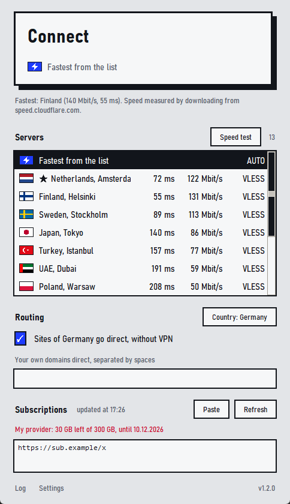
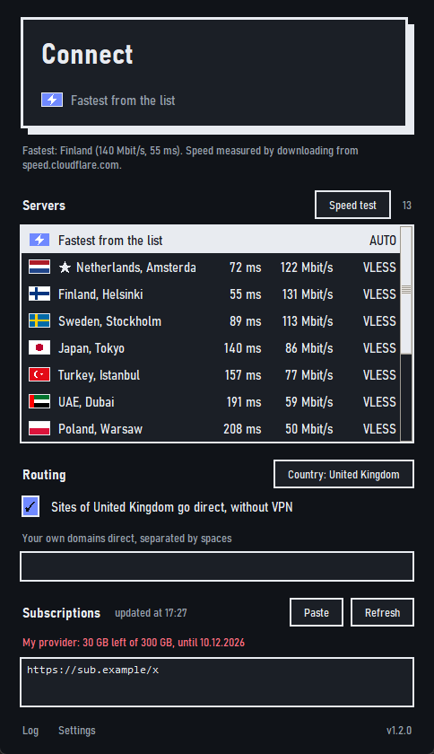

<p align="center"><b>English</b> &nbsp;·&nbsp; <a href="README.ru.md">Русский</a></p>

<p align="center">
  
</p>

<p align="center">
  <a href="https://github.com/serafimbelskih32-source/windows-vpn-client/releases/latest"></a>
  <a href="https://github.com/serafimbelskih32-source/windows-vpn-client/releases"></a>
  
  <a href="LICENSE"></a>
</p>

<h3 align="center">Paste a subscription. Pick a server. Press the button.</h3>

<p align="center">
  A simple VPN client for Windows, Linux and macOS. Free and open source.<br>
  Nothing to install: download and run. Works in any country, in English or Russian.
</p>

<p align="center">
  <a href="https://serafimbelskih32-source.github.io/windows-vpn-client/"><b>Website</b></a> &nbsp;|&nbsp;
  <a href="#download">Download</a> &nbsp;|&nbsp;
  <a href="#getting-started">Getting started</a> &nbsp;|&nbsp;
  <a href="#features">Features</a> &nbsp;|&nbsp;
  <a href="#auto-update">Auto-update</a> &nbsp;|&nbsp;
  <a href="#faq">FAQ</a>
</p>

<p align="center">
  
  &nbsp;&nbsp;
  
</p>
<p align="center"><sub>Light and dark. Theme, accent colour, scale and font are in the advanced settings (double-click “Settings”).</sub></p>

## Download

<p align="center">
  <a href="https://github.com/serafimbelskih32-source/windows-vpn-client/releases/latest/download/FimaVPN.exe"></a>
  <a href="https://github.com/serafimbelskih32-source/windows-vpn-client/releases/latest/download/FimaVPN-linux-x86_64"></a>
  <a href="https://github.com/serafimbelskih32-source/windows-vpn-client/releases/latest/download/FimaVPN-linux-arm64"></a>
  <a href="https://github.com/serafimbelskih32-source/windows-vpn-client/releases/latest/download/FimaVPN-macos-arm64.zip"></a>
  <a href="https://github.com/serafimbelskih32-source/windows-vpn-client/releases/latest/download/FimaVPN-macos-x86_64.zip"></a>
</p>

| System | How to start it |
|---|---|
| **Windows** | Run `FimaVPN.exe` and allow administrator rights. |
| **Linux** | `chmod +x FimaVPN-linux-x86_64`, then `./FimaVPN-linux-x86_64`. For ARM64 the same with the other file. |
| **macOS** | Unzip the archive. The first time, right-click the app and choose “Open”. |

All files and checksums: [the release page](https://github.com/serafimbelskih32-source/windows-vpn-client/releases/latest).

> [!NOTE]
> The program **does not sell or provide a VPN**. It connects to servers you already have a link for, from a VPN provider or your own server.

> [!WARNING]
> The **Linux and macOS** builds are new: they are built and checked automatically on GitHub (the window opens, links are parsed, the whole chain from the program to a server works), but they have not been run on real hardware by the author. If something looks or works wrong, open an [Issue](https://github.com/serafimbelskih32-source/windows-vpn-client/issues) with a screenshot and the text from “Log”.

## Getting started

0. **Choose a language and a country.** It is asked once, at the first start, and can be changed later with the “Country” button next to “Routing”. Sites of the chosen country (banks, government services, local services) open directly, without the VPN. The suggested country is detected for you; “None” sends everything through the VPN.
1. **Run the program.** Windows asks for administrator rights to create a virtual network adapter: press “Yes”. On Linux and macOS only the VPN core asks for a password, when you press Connect.
2. **Paste a subscription.** Copy the link your VPN provider gave you (it usually starts with `https://`) and press “Paste” in the “Subscriptions” section. You can paste several links, or single keys (`vless://`, `vmess://`, `trojan://`, `ss://`, `hysteria2://`, `tuic://`), one per line.
3. **Choose a server.** “Fastest from the list” picks one itself and switches by itself if the server gets worse. To choose by hand, press “Speed test”: the program measures ping and speed and puts the best servers on top.
4. **Press “Connect”.** The big button turns blue and a timer starts. To turn the VPN off, press it again.

Subscriptions, settings and the chosen server are remembered; nothing to type at the next start.

## Features

**Connection**
- **Protocols:** VLESS (Reality, gRPC, WebSocket, HTTPUpgrade, QUIC), VMess, Trojan, Shadowsocks (with plugins), Hysteria and Hysteria2 (including port hopping), TUIC, AnyTLS, WireGuard, NaiveProxy, SSH, SOCKS. **XHTTP, mKCP, VLESS with its own encryption and TCP with an HTTP header** are not run by the sing-box core: [Xray](https://github.com/XTLS/Xray-core) runs them, it sits next to the program and starts by itself when such servers are needed. Only AmneziaWG, ShadowsocksR and Snell are not supported.
- **Any kind of subscription.** A subscription link, single keys, base64 text, sing-box files, Xray (including a list of several configs), Clash and Clash Meta (including one-line entries), Shadowsocks SIP008. The box accepts an “open in the app” link (sing-box://, clash://, hiddify://, v2rayn://, sub://), an address without https://, in quotes, in brackets or inside a sentence: the program finds the address itself. What neither engine can run (AmneziaWG, ShadowsocksR) is skipped, and the program says how many servers and why.
- **Traffic left and expiry date** are shown above the subscription box when the provider reports them.
- **Programs outside the VPN**, or **only these programs through the VPN** (the “Programs” section of the advanced settings), **pinned servers** (right-click), **start at login** with an immediate connection.
- **Shows which server it is connected to.** With “Fastest from the list” the big button says “Auto: …” with the name and flag of the real server, and the row in the list is blue. If auto choice switches, the text changes.
- **Changes the server without reconnecting.** Click another server while connected and the connection moves to it in a moment, with no “Disconnect, Connect”. The network adapter stays up the whole time, so nothing can leave around the VPN while the server changes; open connections close and the applications reopen them through the new server. If the server you picked does not answer, the program says so and **no traffic goes at all** (not directly either) until you pick another. A server that appeared in the list after you connected needs one reconnect; the program tells you so and stays on the current one.
- **Chooses by ping and speed together.** The lowest ping can sit on a 5 Mbit/s line, and a server with a ping a little higher can give 150 Mbit/s. Ping matters for messages, calls, games and opening pages (they are mostly waiting); speed matters for video and downloads (they are mostly bytes). “Fastest from the list” weighs both: right after connecting it measures the speed of the best few servers by ping (a few seconds, tens of megabytes), repeats that every half hour, moves the connection to the best one only when the gain is clear, and goes to the next best (within about half a minute) if the server it is on stops answering. The list is ordered the same way. In the advanced settings you choose what matters more: **Balanced**, **Response time** (calls, games, websites) or **Speed** (video, downloads), or switch speed off (then only the ping counts, as before).
- **Does not pick a server in your own country if that country blocks sites.** The program finds out which country you reach the internet from (outside the VPN). If it is a country where blocking happens (Russia, Belarus, China, Iran and a few others), “Fastest from the list” skips servers that exit there: they cannot get around the blocking. They are grey in the list and can still be chosen by hand; the function can be turned off in “Settings”. In other countries your own servers are used like any other.
- **Your country's sites without the VPN.** The “Sites of the country go direct” box lets local services bypass the VPN and sends the rest through it. It works for any of more than 80 countries: the country's domain endings and its address lists (sing-geoip, and for Russia, China and Iran also lists of sites) are refreshed weekly. Your own exceptions can be added in the box below.
- **Two languages.** The interface is in English and Russian; the language is chosen at the first start and changed in the same place as the country. The system's language is detected for you.
- **Does not leave the network broken.** If the window is closed abnormally, the VPN core ends with it and the internet does not disappear.

**Servers**
- **An honest test.** Ping (response on an already open connection), download speed and the country a server really exits from. The test goes around any VPN that is on. All servers are pinged at once, but speed is measured one by one: otherwise the servers share the channel and the numbers lie.
- **The flag shows the server's real country.** Before the test the flag comes from the name, after it from Cloudflare's answer: a provider's name may not match reality. If it does not, this is written under the big button.
- **Subscriptions refresh themselves** at the interval the provider gives. If the provider is unreachable, the last saved servers stay. If a subscription cannot be loaded, the program says why in plain words (certificate, DNS, blocking, the site's refusal) and tries ways around it itself: a backup DNS and loading through the VPN that is already on. A provider that gives different lists to different programs is asked as several programs, and the servers are merged.

**Look and comfort**
- **Minimal look.** In “Settings” (the small grey link at the bottom) flags, ping and speed are switched on and off **separately**. What is off is not shown and **not measured**: without speed the test downloads nothing, without ping it measures no response.
- **Advanced settings for experienced users.** Double-click “Settings” to open a window of its own: appearance (light, dark, high-contrast or the system's theme; an accent colour from the list or your own; scale; font; border thickness; list density; window width, opacity and position), the programs section, the local proxy port, the network adapter mode, strict routing, DNS servers, parameters of “Fastest from the list” and of the speed test, the log level, reconnecting. A live picture above the appearance settings shows how the program will look before the restart. An ordinary user needs to change nothing there; a value the core does not accept is replaced by the usual one and the program connects anyway.
- **A tray icon.** Windows: by the clock at the bottom right, often under the “^” arrow. macOS: the menu bar. Linux: the system tray. Grey icon: the VPN is off, blue: connected. The menu: “Show window”, “Connect” or “Disconnect”, “Quit”. By default the close button hides the program in the tray instead of turning the VPN off: this can be changed in “Settings”.
- **A second launch does not pile up windows.** If the program is already running (also in the tray), a second launch brings its window forward.

## Auto-update

The first time you run the program it asks whether to update automatically. If you agree:

| When | What happens |
|---|---|
| **At every start** and **every 6 hours** while it runs | The program asks GitHub whether there is a new version. It does not learn of a release instantly: it appears about 10 minutes after it is published and is found at the next check. |
| A new version is found | The file is downloaded in the background only from GitHub (over `https` and only from GitHub addresses) and its **checksum is compared** with `SHA256SUMS.txt` from the same release. If the checksum does not match, the file is thrown away. |
| The **next start** or **quit** | The new version is installed; the VPN is not interrupted while the program runs. Closing the window to the tray does not count: a real quit is needed (“Quit” in the icon's menu). |
| You need it now | In “Settings” press “Check” and then “Install”: the program turns the VPN off and restarts. |

Auto-update can be switched on and off, and the version checked by hand, in “Settings” at the bottom of the window; the installed version is written to the right of them. With auto-update off the program checks and downloads nothing by itself.

> [!IMPORTANT]
> The checksum protects against a damaged download, but not against the release itself being replaced: the update trusts this repository. If you do not want that, turn auto-update off and build from source.

## FAQ

<details>
<summary><b>Windows says “Windows protected your PC”</b></summary>

The program is not signed with a paid certificate, so SmartScreen and some antiviruses get cautious. Press “More info” → “Run anyway”. If you do not trust the ready-made file, build it yourself from source (below): everything is open.
</details>

<details>
<summary><b>macOS says the program cannot be opened</b></summary>

Right-click it, choose “Open” and confirm. Once is enough. Or in the terminal: `xattr -dr com.apple.quarantine FimaVPN.app`.
</details>

<details>
<summary><b>On Linux the password window does not open</b></summary>

`pkexec` (the `polkit` package) and a running polkit graphical agent are needed: ordinary desktops (GNOME, KDE, XFCE) have it. Without it you cannot connect: the VPN core needs rights to create a network adapter.
</details>

<details>
<summary><b>I cannot see the tray icon</b></summary>

On Windows new icons hide under the “^” arrow by the clock: drag the icon to the bar so it is always in view. On Linux the icon is visible in desktops with a tray (XFCE, KDE, MATE and others); GNOME has no tray by default, install the AppIndicator extension. If there is no icon at all, the program works as usual and the close button simply closes it.
</details>

<details>
<summary><b>It does not connect</b></summary>

Open “Log” at the bottom of the window: the reason is there. Common causes: the subscription expired (check it in the provider's account), another VPN is running (Karing, v2rayN, Hiddify, NekoRay: turn it off), on Windows there are no administrator rights.
</details>

<details>
<summary><b>Where do I get a subscription?</b></summary>

From a VPN provider, or from your own server (3x-ui, Marzban and Remnawave panels give such links).
</details>

<details>
<summary><b>Where is my data stored?</b></summary>

Windows: `%APPDATA%\FimaVPN`. Linux: `~/.config/FimaVPN`. macOS: `~/Library/Application Support/FimaVPN`. Settings, saved servers and logs are there. Subscription links work like a password: do not publish them or send them to others.
</details>

<details>
<summary><b>Which country should I choose?</b></summary>

The one you are in. Its sites (banks, government services, local shops) then open without the VPN, which is faster and does not trip services that distrust foreign addresses. The country is suggested from your connection and system settings. If you want everything through the VPN, choose “None”.
</details>

## Building from source

Python 3.12+ with tkinter is needed.

```powershell
# Windows
git clone https://github.com/serafimbelskih32-source/windows-vpn-client.git
cd windows-vpn-client
.\build.ps1
```

```sh
# Linux and macOS
git clone https://github.com/serafimbelskih32-source/windows-vpn-client.git
cd windows-vpn-client
./build.sh
```

The script downloads the sing-box 1.13.14 core (and Xray for XHTTP) and builds the program into the `dist` folder. All release builds are made by [GitHub Actions](.github/workflows/release.yml): push a `v…` tag and the builds for every system appear in the release together with `SHA256SUMS.txt`.

Checks (each runs as `python tests/<name>.py`): `test_sources` (every kind of subscription and link), `test_engines` (Xray, WireGuard, the whole chain), `test_i18n` (translations and countries), `test_choice` (ping and speed weighed together), `test_switch` (changing the server of a running real core, and that nothing leaks), `test_autochoice` (what the window does about it), `test_english` and `test_design` (the window in several languages, fonts and scales), `test_features`, `test_app`, `test_robust`, `test_updater`, `test_flags`, `test_tray`, `test_supervisor`. `tests/shots.py` takes pictures of every window.

## Licences

The program's code is released under the MIT licence (the `LICENSE` file). It runs the [sing-box](https://github.com/SagerNet/sing-box) core under GPL-3.0 and [Xray-core](https://github.com/XTLS/Xray-core) under MPL-2.0 (details in `THIRD_PARTY_NOTICES.md`).
