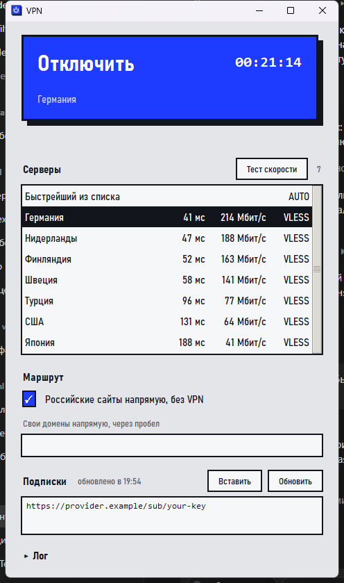
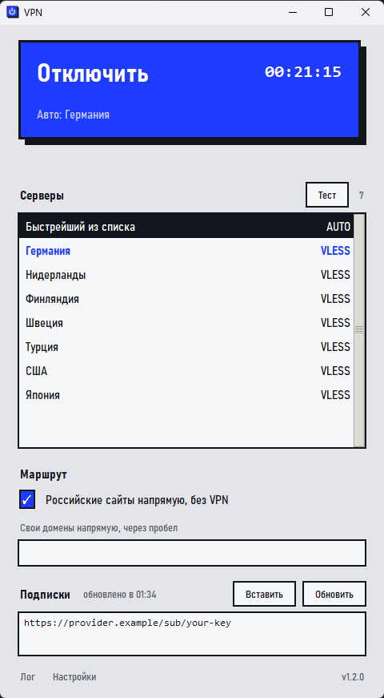

<p align="center"><a href="README.md">English</a> &nbsp;·&nbsp; <b>Русский</b></p>

<p align="center">
  
</p>

<p align="center">
  <a href="https://github.com/serafimbelskih32-source/windows-vpn-client/releases/latest"></a>
  <a href="https://github.com/serafimbelskih32-source/windows-vpn-client/releases"></a>
  
  <a href="LICENSE"></a>
</p>

<h3 align="center">Вставил подписку. Выбрал сервер. Нажал кнопку.</h3>

<p align="center">
  Простой VPN-клиент для Windows, Linux и macOS. Бесплатный, с открытым кодом.<br>
  Устанавливать ничего не нужно: скачал и запустил. Работает в любой стране: при первом запуске выбираешь язык и страну.
</p>

<p align="center">
  <a href="https://serafimbelskih32-source.github.io/windows-vpn-client/"><b>Сайт</b></a> &nbsp;|&nbsp;
  <a href="#скачать">Скачать</a> &nbsp;|&nbsp;
  <a href="#как-начать">Как начать</a> &nbsp;|&nbsp;
  <a href="#что-умеет">Что умеет</a> &nbsp;|&nbsp;
  <a href="#автообновление">Автообновление</a> &nbsp;|&nbsp;
  <a href="#частые-вопросы">Вопросы</a>
</p>

<p align="center">
  
  &nbsp;&nbsp;
  
</p>
<p align="center"><sub>Полный вид и минималистичный. Всё лишнее отключается в «Настройках» внизу окна.</sub></p>

## Скачать

<p align="center">
  <a href="https://github.com/serafimbelskih32-source/windows-vpn-client/releases/latest/download/FimaVPN.exe"></a>
  <a href="https://github.com/serafimbelskih32-source/windows-vpn-client/releases/latest/download/FimaVPN-linux-x86_64"></a>
  <a href="https://github.com/serafimbelskih32-source/windows-vpn-client/releases/latest/download/FimaVPN-linux-arm64"></a>
  <a href="https://github.com/serafimbelskih32-source/windows-vpn-client/releases/latest/download/FimaVPN-macos-arm64.zip"></a>
  <a href="https://github.com/serafimbelskih32-source/windows-vpn-client/releases/latest/download/FimaVPN-macos-x86_64.zip"></a>
</p>

| Система | Как запустить |
|---|---|
| **Windows** | Запусти `FimaVPN.exe` и разреши права администратора. |
| **Linux** | `chmod +x FimaVPN-linux-x86_64`, потом `./FimaVPN-linux-x86_64`. Для ARM64 то же с другим файлом. |
| **macOS** | Распакуй архив. При первом запуске нажми на программу правой кнопкой и выбери «Открыть». |

Все файлы и контрольные суммы: [страница релиза](https://github.com/serafimbelskih32-source/windows-vpn-client/releases/latest).

> [!NOTE]
> Программа **не продаёт и не выдаёт VPN**. Она подключается к серверам, ссылку на которые у тебя уже есть от провайдера или от твоего собственного сервера.

> [!WARNING]
> Версии для **Linux и macOS** новые: они собираются и проходят автоматические проверки на GitHub (окно открывается, ссылки разбираются, логика запуска и остановки ядра проверена на подставном ядре), но на настоящих компьютерах проверены меньше, чем версия для Windows. Если что-то не работает, [открой Issue](https://github.com/serafimbelskih32-source/windows-vpn-client/issues/new/choose) и приложи текст из раздела «Лог».

## Как начать

0. **Выбери язык и страну** (спросит один раз при первом запуске, потом это меняется кнопкой «Страна» рядом с «Маршрут»). Сайты выбранной страны (банки, госуслуги, местные сервисы) будут открываться напрямую, без VPN. Предложенная страна определяется автоматически, а «Нигде» отправляет через VPN всё.
1. **Запусти программу.** Windows спросит права администратора, чтобы создать виртуальный сетевой адаптер: нажми «Да». На Linux и macOS пароль попросят позже, в момент подключения.
2. **Вставь подписку.** Скопируй ссылку, которую выдал твой VPN-провайдер (обычно начинается с `https://`), и нажми «Вставить» в разделе «Подписки». Можно вставить сразу несколько ссылок или отдельные ключи (`vless://`, `vmess://`, `trojan://`, `ss://`, `hysteria2://`, `tuic://`), по одному в строке.
3. **Выбери сервер.** «Быстрейший из списка» подберёт его сам и сам будет переключаться, если сервер станет хуже. Чтобы выбрать вручную, нажми «Тест скорости»: программа измерит пинг и скорость у серверов и покажет лучших вверху списка.
4. **Нажми «Подключить».** Большая кнопка станет синей, рядом пойдёт таймер. Чтобы выключить VPN, нажми её ещё раз.

Подписки, настройки и выбранный сервер запоминаются, при следующем запуске вводить ничего не нужно.

## Что умеет

**Подключение**
- **Протоколы:** VLESS (Reality, gRPC, WebSocket, HTTPUpgrade, QUIC), VMess, Trojan, Shadowsocks (с плагинами), Hysteria и Hysteria2 (в том числе со сменой портов), TUIC, AnyTLS, WireGuard, NaiveProxy, SSH, SOCKS. **XHTTP, mKCP, VLESS со своим шифрованием и TCP с заголовком HTTP** ядро sing-box не запускает, их запускает Xray, который лежит рядом и стартует сам, когда такие серверы нужны. Не поддерживается только AmneziaWG, ShadowsocksR и Snell.
- **Остаток трафика и срок подписки** видны над полем подписок, если провайдер их сообщает.
- **Программы мимо VPN** и **только через VPN** (раздел «Программы» в расширенных настройках), **закрепление серверов** (правая кнопка мыши), **автозапуск** при входе в систему с подключением сразу.
- **Подписки любого вида.** Ссылка подписки, ключи по одному, текст в base64, файл sing-box, Xray (в том числе список из нескольких конфигов), Clash и Clash Meta (в том числе однострочные записи), Shadowsocks SIP008. В поле можно вставить ссылку «открыть в приложении» (sing-box://, clash://, hiddify://, v2rayn://, sub://), адрес без https://, адрес в кавычках, в скобках или внутри фразы: программа сама достанет адрес. Если в подписке есть то, что не умеет никто из двух ядер (AmneziaWG, ShadowsocksR), эти серверы пропускаются, а программа говорит, сколько их и почему.
- **Показывает, к какому серверу подключён.** Если выбран «Быстрейший из списка», на большой кнопке написано «Авто: …» с названием и флагом реального сервера, а строка в списке выделена синим. Если автовыбор переключился, надпись меняется.
- **Меняет сервер без переподключения.** Нажми на другой сервер, когда VPN включён, и соединение за мгновение перейдёт на него, без «Отключить, Подключить». Сетевой адаптер всё время остаётся на месте, поэтому пока сервер меняется, ничего не уходит мимо VPN; открытые соединения закрываются, и программы открывают их заново уже через новый сервер. Если выбранный сервер не отвечает, программа так и скажет, а **трафик не пойдёт совсем** (и напрямую тоже), пока ты не выберешь другой. Сервер, который появился в списке уже после подключения, требует одного переподключения: программа об этом скажет и останется на текущем.
- **Выбирает по отклику и скорости вместе.** Самый низкий пинг может оказаться на канале в 5 Мбит/с, а у сервера с чуть большим пингом бывает 150 Мбит/с. Пинг важен для сообщений, звонков, игр и открытия страниц (там почти всё время уходит на ожидание); скорость важна для видео и загрузок (там почти всё время уходит на сами байты). «Быстрейший из списка» учитывает оба: сразу после подключения он измеряет скорость у нескольких лучших по пингу серверов (несколько секунд, десятки мегабайт), повторяет это раз в полчаса, переводит соединение на лучший сервер, только когда выигрыш заметный, и уходит на следующий лучший (примерно за полминуты), если сервер, на котором он сидит, перестал отвечать. Список упорядочен так же. В расширенных настройках выбирается, что важнее: **Поровну**, **Отклик** (звонки, игры, сайты) или **Скорость** (видео, загрузки), либо выключается учёт скорости (тогда решает один пинг, как раньше).
- **Не выбирает сервер в твоей стране, если там блокируют.** Программа сама определяет, из какой страны ты выходишь в интернет (мимо VPN). Если это страна, где блокируют (Россия, Беларусь, Китай, Иран и некоторые другие), «Быстрейший из списка» не берёт серверы с выходом в ней: через них блокировки не обойти. В списке они серые, выбрать такой сервер вручную по-прежнему можно, а саму эту функцию можно выключить в «Настройках». В остальных странах свои серверы выбираются как любые другие.
- **Сайты твоей страны без VPN.** Галочка «Сайты страны напрямую» пускает местные сервисы мимо VPN, а остальное через него. Работает для любой из 80 с лишним стран: домены страны и списки её адресов (sing-geoip, а для России, Китая и Ирана ещё и списки сайтов) обновляются раз в неделю. Свои исключения можно дописать в поле ниже.
- **Два языка.** Интерфейс на русском и английском; язык выбирается при первом запуске и меняется там же, где страна. Язык системы определяется сам.
- **Не оставляет сеть сломанной.** Если окно закрыто аварийно, ядро VPN завершается вместе с ним и интернет не пропадает.

**Серверы**
- **Честный тест.** Пинг (отклик на уже открытом соединении), скорость загрузки и страна, откуда сервер реально выходит в интернет. Тест идёт мимо любого включённого VPN. Пингуются все серверы одновременно, а скорость меряется по одному: иначе серверы делят канал и цифры врут.
- **Флаг показывает реальную страну сервера.** До теста флаг берётся из названия, после теста по ответу Cloudflare: название у провайдера может не совпадать с реальностью. Если не совпало, это написано под большой кнопкой.
- **Подписки обновляются сами** по интервалу, который сообщает провайдер. Если провайдер недоступен, остаются последние сохранённые серверы. Если подписку не загрузить, программа пишет причину простыми словами (сертификат, DNS, блокировка, отказ сайта) и сама пробует обходные пути: запасной DNS и загрузку через уже включённый VPN.

**Вид и удобство**
- **Минималистичный вид.** В «Настройках» (мелкая серая ссылка внизу окна) флаги, пинг и скорость включаются и выключаются **по отдельности**. Что выключено, то не показывается и **не измеряется**: без скорости тест не качает файлы, без пинга не меряет отклик.
- **Расширенные настройки для опытных.** Двойной щелчок по «Настройки» открывает отдельное окно: оформление (тема светлая, тёмная, контрастная или как в системе; цвет акцента или свой; масштаб; шрифт; толщина рамок; плотность списка; ширина, прозрачность и положение окна), порт локального прокси, режим сетевого адаптера, строгий маршрут, DNS-серверы, параметры «Быстрейшего из списка» и теста скорости, подробность журнала, переподключение. Над оформлением есть картинка: видно, как будет выглядеть программа, до перезапуска. Обычному пользователю там ничего менять не нужно; значение, которое не подошло ядру, программа сама заменяет обычным и всё равно подключается.
- **Значок в области уведомлений.** Windows: у часов справа внизу, часто под стрелочкой «^». macOS: строка меню сверху. Linux: системный трей. Серый значок: VPN выключен, синий: подключён. Меню: «Показать окно», «Подключить» или «Отключить», «Выход». По умолчанию кнопка закрытия окна сворачивает программу в трей, а не выключает VPN: это отключается в «Настройках».
- **Повторный запуск не плодит окна.** Если программа уже работает (в том числе в трее), второй запуск выводит её окно вперёд.

## Автообновление

При первом запуске программа спросит, обновляться ли автоматически. Если ты согласился:

| Когда | Что происходит |
|---|---|
| **При каждом запуске** и **раз в 6 часов**, пока программа работает | Программа спрашивает у GitHub, нет ли новой версии. Мгновенно о выходе версии она не узнаёт: релиз появляется примерно через 10 минут после выпуска, а обнаруживается при ближайшей проверке. |
| Нашлась новая версия | Файл скачивается в фоне только с GitHub (по `https` и только с адресов GitHub), его **контрольная сумма сверяется** с файлом `SHA256SUMS.txt` из того же релиза. Если сумма не совпала, файл отбрасывается. |
| **Следующий запуск** или **выход** из программы | Новая версия устанавливается, VPN во время работы не прерывается. Закрытие окна в трей установкой не считается: нужен настоящий выход («Выход» в меню значка). |
| Нужно сразу | В «Настройках» нажми «Проверить», а потом «Установить»: программа отключит VPN и перезапустится. |

Включить и выключить автообновление и проверить версию вручную можно в «Настройках» внизу окна, номер установленной версии написан справа от них. Если автообновление выключено, программа сама ничего не проверяет и не скачивает.

> [!IMPORTANT]
> Контрольная сумма защищает от повреждённой загрузки, но не от подмены самого релиза: обновление доверяет этому репозиторию. Если ты не хочешь этого, выключи автообновление и собирай из исходников.

## Частые вопросы

<details>
<summary><b>Windows пишет «Система Windows защитила ваш компьютер»</b></summary>

Программа не подписана платным сертификатом, поэтому SmartScreen и некоторые антивирусы настораживаются. Нажми «Подробнее» → «Выполнить в любом случае». Если не доверяешь готовому файлу, собери его сам из исходников (ниже): всё открыто.
</details>

<details>
<summary><b>macOS пишет, что программу нельзя открыть</b></summary>

Нажми на неё правой кнопкой, выбери «Открыть» и подтверди. Один раз этого достаточно. Либо в терминале: `xattr -dr com.apple.quarantine FimaVPN.app`.
</details>

<details>
<summary><b>На Linux не открывается окно пароля</b></summary>

Нужен `pkexec` (пакет `polkit`) и запущенный графический агент polkit: в обычных рабочих окружениях (GNOME, KDE, XFCE) он есть. Без него подключиться нельзя: ядру VPN нужны права для создания сетевого адаптера.
</details>

<details>
<summary><b>Значка в трее не видно</b></summary>

В Windows новые значки прячутся под стрелочкой «^» у часов: перетащи значок на панель, чтобы он был всегда на виду. На Linux значок виден в окружениях с треем (XFCE, KDE, MATE и др.); в GNOME трея по умолчанию нет, поставь расширение AppIndicator. Если значка нет вовсе, программа работает как обычно, а кнопка закрытия окна просто закрывает её.
</details>

<details>
<summary><b>Не подключается</b></summary>

Открой раздел «Лог» внизу окна: там причина. Частые причины: подписка устарела (проверь её в кабинете провайдера), запущен другой VPN (Karing, v2rayN, Hiddify, NekoRay: выключи его), на Windows нет прав администратора.
</details>

<details>
<summary><b>Где взять подписку?</b></summary>

У VPN-провайдера или на собственном сервере (панели 3x-ui, Marzban, Remnawave выдают такие ссылки).
</details>

<details>
<summary><b>Где хранятся данные?</b></summary>

Windows: `%APPDATA%\FimaVPN`. Linux: `~/.config/FimaVPN`. macOS: `~/Library/Application Support/FimaVPN`. Там настройки, сохранённые серверы и логи. Ссылки-подписки работают как пароль: не публикуй их и не присылай другим.
</details>

## Сборка из исходников

Нужен Python 3.12+ с tkinter.

```powershell
# Windows
git clone https://github.com/serafimbelskih32-source/windows-vpn-client.git
cd windows-vpn-client
.\build.ps1
```

```sh
# Linux и macOS
git clone https://github.com/serafimbelskih32-source/windows-vpn-client.git
cd windows-vpn-client
./build.sh
```

Скрипт скачает ядро sing-box 1.13.14 (и Xray для XHTTP) и соберёт программу в папку `dist`. Все версии для релиза собирает [GitHub Actions](.github/workflows/release.yml): достаточно поставить тег `v…`, и сборки под все системы появятся в релизе вместе с `SHA256SUMS.txt`.

Проверки (каждая запускается как `python tests/<имя>.py`): `test_sources` (все виды подписок и ссылок), `test_engines` (Xray, WireGuard, цепочка целиком), `test_i18n` (переводы и страны), `test_choice` (отклик и скорость вместе), `test_switch` (смена сервера у работающего настоящего ядра и то, что ничего не утекает), `test_autochoice` (что делает окно), `test_english` и `test_design` (окно на разных языках, шрифтах и масштабах), `test_features`, `test_app`, `test_robust`, `test_updater`, `test_flags`, `test_tray`, `test_supervisor`. `tests/shots.py` делает снимки всех окон.

## Лицензии

Код программы распространяется под лицензией MIT (файл `LICENSE`). Внутри работает ядро [sing-box](https://github.com/SagerNet/sing-box) под GPL-3.0 (подробности в `THIRD_PARTY_NOTICES.md`).
